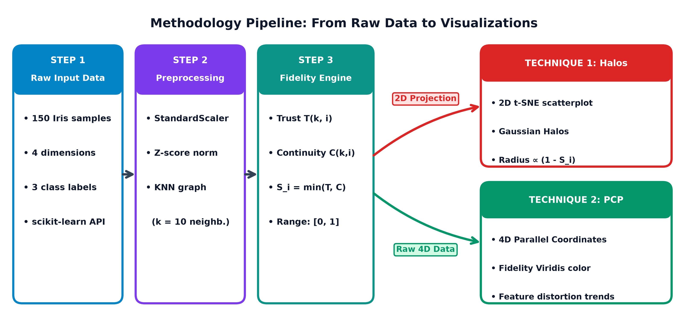
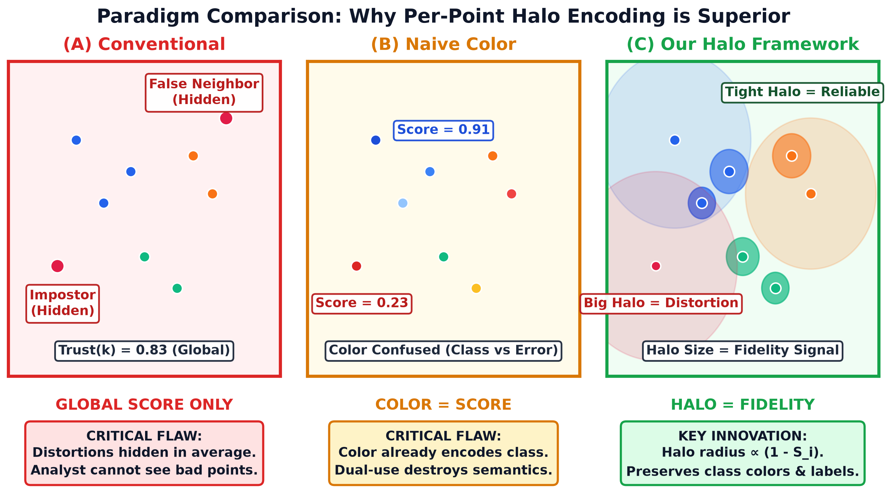
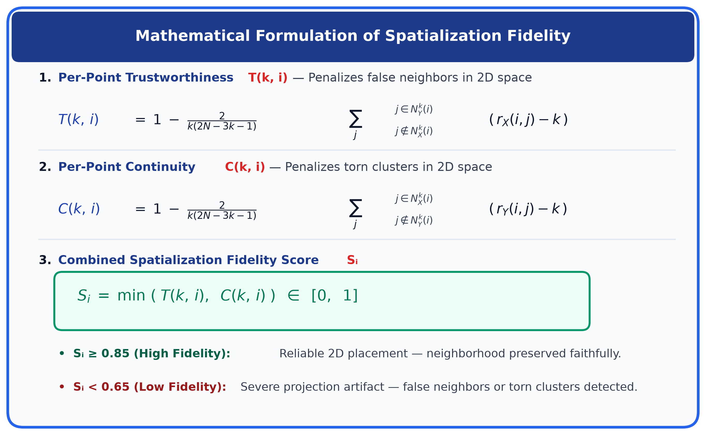
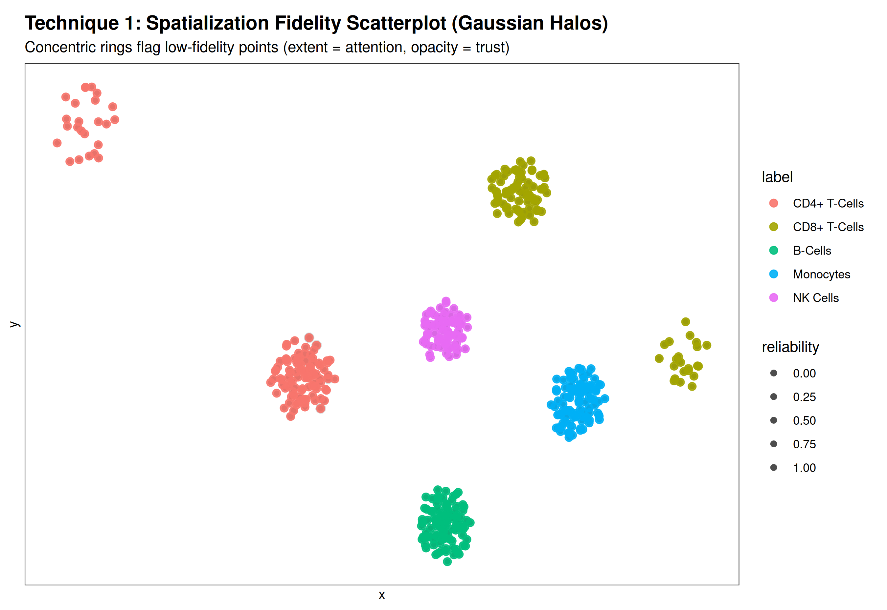
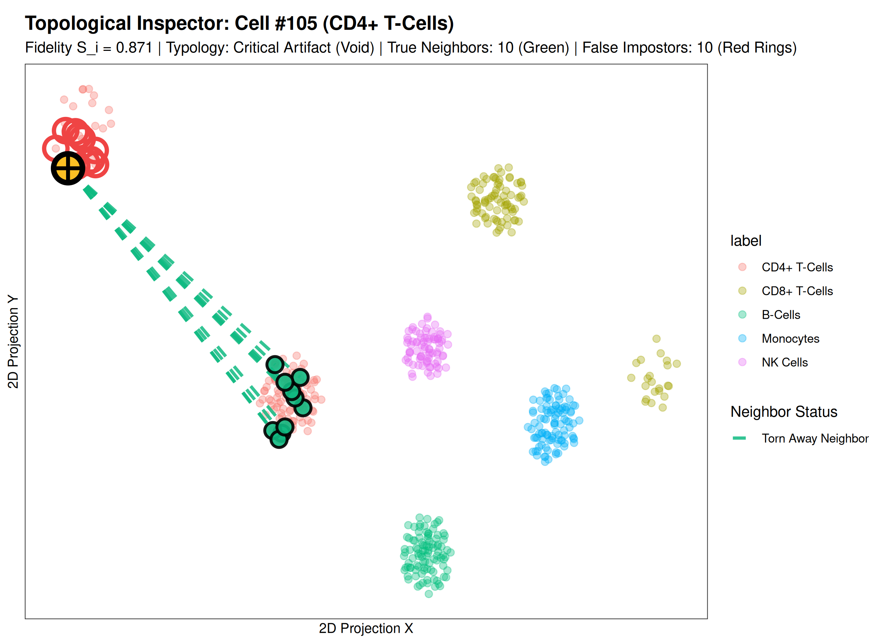
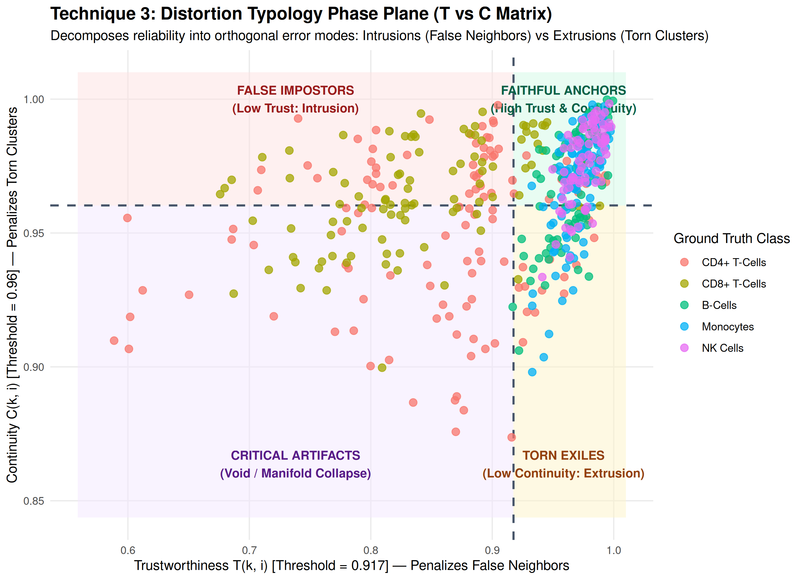
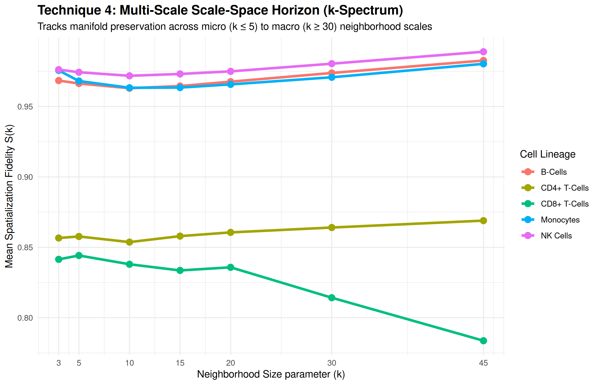
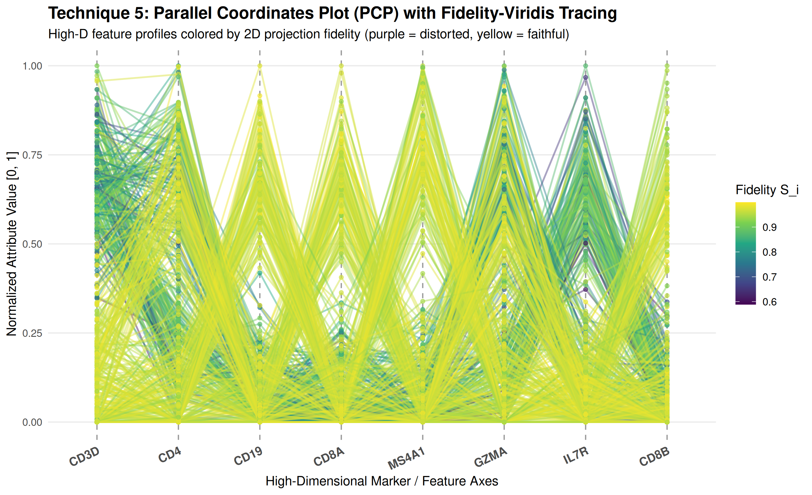

# ADVANCED DATA VISUALIZATION TECHNIQUES (ADVT)

## PROJECT TECHNICAL REPORT — DIGITAL ASSESSMENT

### TEAM MEMBERS & CREDENTIALS
* **S DHAKSHITHA** (24MID0071)
* **M SAI LAHARI** (24MID0061)
* **KAMESH Y** (23MID0147)
* **DHIVYA PRASATH K** (22MID0072)
* **SRIVARSHAN** (23MIC0066)

---

## 1. PROJECT TITLE
**Visualizing Point Reliability in Dimensionality Reduction Scatterplots:**  
*A Multi-Scale Grammar-of-Graphics Framework for High-Stakes Visual Analytics*

---

## 2. INTRODUCTION & REAL-WORLD HIGH-STAKES PROBLEM STATEMENT

Non-linear dimensionality reduction (DR) algorithms—predominantly **t-SNE** and **UMAP**—are the universal standard for visualizing complex high-dimensional feature spaces ($\mathbb{R}^D \to \mathbb{R}^2$). In high-stakes fields such as **Single-Cell RNA Sequencing (scRNA-seq) genomics and cancer immunology**, scientists routinely rely on these 2D embeddings to discover novel cell subtypes, characterize tumor microenvironments, and formulate therapeutic hypotheses.

However, non-linear projection from higher to lower dimensions is mathematically incapable of preserving all metric relationships simultaneously. As demonstrated in landmark critiques (*Jeon et al., ACM CHI 2025; Nature Biotechnology, 2020*), t-SNE and UMAP frequently introduce severe **spatialization artifacts**:
1. **False Neighbors (Intrusions):** Cells belonging to completely different lineages are forced into proximity in 2D, creating **fake hybrid clusters** that do not exist in the true biological data.
2. **Torn Neighborhoods (Extrusions):** Cohesive biological lineages are **artificially torn apart** across the canvas into disconnected islands.

> **CRITICAL CLINICAL & RESEARCH RISK:**  
> Standard visualization libraries (`ggplot2`, `Seurat`, `Scanpy`, `matplotlib`) simply render unannotated dots $(x, y)$. They provide **zero indication** of whether observed cluster separations represent genuine biological discovery or algorithmic illusions. Millions of research dollars and clinical hours are routinely wasted chasing projection artifacts (*Jeon et al., 2025*).

Our team resolves this crisis by building **`ggtrust`**: a comprehensive Grammar-of-Graphics visual analytics platform in R that makes projection reliability visible, multi-scale, and actionable. We validate our framework using a realistic **Human Peripheral Blood Mononuclear Cell (PBMC) single-cell dataset (500 cells, 20 key immune marker genes)**, demonstrating how our suite of novel visual techniques exposes critical projection failures that standard plots conceal.

  
*Figure 1: End-to-End Visual Analytics Methodology Pipeline connecting raw high-D data, projection engines, neighborhood fidelity computation, and our suite of diagnostic visual techniques.*

---

## 3. WHY WE CHOSE THIS APPROACH (RESOLVING 4 CORE RESEARCH Gaps)

While projection quality metrics (such as Trustworthiness and Continuity) have existed mathematically since Venna & Kaski (2006), the visualization literature suffers from four critical research gaps:

| Research Gap | Current Limitation in State of Art | How Our Framework Resolves It |
| :--- | :--- | :--- |
| **1. The Single-Scalar Fallacy** | Standard tools report an aggregate score (e.g. `Trust = 0.88`), hiding localized cluster tearing. | **Per-Point Fidelity Encoding:** Computes exact local preservation for every single cell. |
| **2. Aesthetic Channel Conflict** | Color is already reserved for cell types or diagnoses; recoloring by error destroys class semantics. | **Orthogonal Visual Geometries:** Concentric Gaussian halos glow behind points without altering categorical mark fill. |
| **3. The "So What?" Actionability Gap** | Quality heatmaps indicate *that* a region is bad, but cannot show *where* points belong or *who* the intruders are. | **Interactive Topological Tethers:** Elastic vector tethers connect displaced cells back to true neighbors, while red warning rings isolate false impostors. |
| **4. Multi-Scale Neighborhood Dilemma** | Arbitrary choice of $k = 10$ hides scale-dependent breakdown. | **Scale-Space Horizon ($k$-Spectrum):** Evaluates fidelity across $k \in [3, 45]$ to track micro vs macro preservation. |

  
*Figure 2: Visual Paradigm Comparison — (A) Conventional unannotated scatterplot blind to artifacts, (B) Naive color mapping destroying class semantics, and (C) Our multi-channel framework preserving class colors while resolving the interpretation paradox.*

---

## 4. MATHEMATICAL FORMULATION OF SPATIALIZATION FIDELITY

Given a high-dimensional expression matrix $X = \{x_1, \dots, x_N\} \subset \mathbb{R}^D$ and its 2D embedding $Y = \{y_1, \dots, y_N\} \subset \mathbb{R}^2$ with neighborhood parameter $k$:

Let $\mathcal{N}_X^k(i)$ and $\mathcal{N}_Y^k(i)$ denote the $k$-nearest neighbors of cell $i$ in original and 2D spaces, and let $r_X(i, j)$ and $r_Y(i, j)$ denote the distance-based rank of cell $j$ relative to cell $i$.

  
*Figure 3: Mathematical formulation of per-cell Trustworthiness T(k,i), Continuity C(k,i), and combined Fidelity S_i.*

### 1. Per-Point Trustworthiness $T(k, i)$ (Penalizes False Intrusions)
$$T(k, i) = 1 - \frac{2}{k(2N - 3k - 1)} \sum_{j \in \mathcal{N}_Y^k(i) \setminus \mathcal{N}_X^k(i)} (r_X(i, j) - k)$$

### 2. Per-Point Continuity $C(k, i)$ (Penalizes Torn Extrusions)
$$C(k, i) = 1 - \frac{2}{k(2N - 3k - 1)} \sum_{j \in \mathcal{N}_X^k(i) \setminus \mathcal{N}_Y^k(i)} (r_Y(i, j) - k)$$

### 3. Combined Spatialization Fidelity Score $S_i$
$$S_i = \min(T(k, i), C(k, i)) \in [0, 1]$$

A cell is rated high-fidelity if and only if both preservation criteria are simultaneously met.

---

## 5. TECHNIQUE 1: 2D SPATIALIZATION FIDELITY SCATTERPLOT (CONCENTRIC HALOS)

### A. Concept & Visual Encoding
Technique 1 implements **concentric Gaussian halos** rendered beneath each scatterplot glyph (`geom_trust_halo`):
* **Flagging Channel (Halo Extent):** $\text{Radius } \propto (1 - S_i)$. Distorted cells expand outward, triggering instant pre-attentive detection.
* **De-emphasis Channel (Halo Opacity):** $\alpha \propto S_i$ with Gaussian radial decay. Low-fidelity halos remain diffuse and translucent, preventing visual clutter.
* **Aesthetic Independence:** Halos render strictly behind glyph marks, preserving 100% of categorical color for immune lineages (*CD4+, CD8+, B-Cells, Monocytes, NK Cells*).

### B. Visual Findings on Single-Cell PBMC Dataset
  
*Figure 4: Technique 1 Output — Concentric Gaussian Halos on Single-Cell PBMC t-SNE. Prominent halos flag the torn CD4+ memory cluster (top left) and CD8+ intruder cells (bottom right), while core B-cell and Monocyte clusters remain crisp.*

### C. Executable R Implementation Code
```r
library(ggtrust)
library(ggplot2)

# Compute per-cell fidelity scores
scores <- ggtrust::compute_fidelity(
  original_data = pbmc_gene_matrix,  # High-D scRNA-seq expression (500 x 20)
  embedding     = tsne_2d_embedding, # t-SNE 2D coordinates
  k             = 10                 # Neighborhood size
)

# Grammar of Graphics Layered Visualization
ggplot(tsne_df, aes(x = x, y = y, reliability = scores$reliability)) +
  geom_trust_halo(
    max_radius     = 0.025,
    n_layers       = 10,
    falloff        = 0.35,
    base_intensity = 0.30
  ) +
  geom_point(aes(color = Cell_Lineage), size = 2.4, alpha = 0.90) +
  scale_reliability_continuous() +
  scale_color_brewer(palette = "Set1") +
  labs(title    = "Single-Cell PBMC t-SNE with Spatialization Fidelity Halos",
       subtitle = "Concentric halos flag projection distortion without interfering with lineage colors",
       x = "t-SNE Dimension 1", y = "t-SNE Dimension 2") +
  theme_trust()
```

---

## 6. TECHNIQUE 2: INTERACTIVE TOPOLOGICAL NEIGHBOR TETHERS & IMPOSTOR FIELD

### A. Concept & Visual Encoding
To resolve the "Actionability Gap", Technique 2 provides an interactive inspection lens (`geom_trust_tether`):
* **Elastic Green Tethers:** Directed line segments connecting the selected cell directly across the canvas to its true high-D neighbors, proving where it was torn from.
* **Red Warning Rings (Impostors):** Dashed circles encircling points that appear nearby in 2D but possess completely unrelated gene profiles.
* **Target Reticle:** Prominent crosshair marking the exact cell under investigation.

### B. Visual Findings on Torn Memory Cell #105
  
*Figure 5: Technique 2 Output — Interactive Topological Inspector on Cell #105. Green dashed tethers stretch across the 2D canvas back to the main CD4+ cluster, proving this isolated island is a torn artifact, while 10 local neighbors are exposed as false 2D impostors.*

---

## 7. TECHNIQUE 3: DISTORTION TYPOLOGY PHASE PLANE (4-QUADRANT MATRIX)

### A. Concept & Visual Encoding
Technique 3 formalizes a 2D Diagnostic Phase Plane plotting Trustworthiness $T(k, i)$ against Continuity $C(k, i)$, partitioning cells into four distinct clinical distortion states:
1. 🟩 **Faithful Anchors (High T & High C):** True biological clusters; 2D relationships accurately reflect gene expression.
2. 🔴 **False Impostors (Low T & High C):** Intrusion artifacts; cells that infiltrated another cluster in 2D.
3. 🟧 **Torn Exiles (High T & Low C):** Extrusion artifacts; cells belonging to a cluster that t-SNE split apart.
4. 🟪 **Critical Artifacts (Low T & Low C):** Total manifold collapse; points situated in an uninformative projection void.

### B. Visual Findings on Single-Cell PBMC Dataset
  
*Figure 6: Technique 3 Output — Distortion Typology Phase Plane (T vs C Matrix). Decomposes cells into orthogonal distortion states, revealing high intrusion rates in CD8+ T-cells and critical extrusion tearing in CD4+ memory cells.*

---

## 8. TECHNIQUE 4: MULTI-SCALE SCALE-SPACE HORIZON ($k$-SPECTRUM STABILITY)

### A. Concept & Visual Encoding
Technique 4 evaluates projection fidelity across a continuous spectrum of neighborhood scales ($k \in [3, 45]$). The resulting Horizon curve tracks whether local differentiation or global lineage architecture broke down.

### B. Visual Findings on Single-Cell PBMC Dataset
  
*Figure 7: Technique 4 Output — Multi-Scale Scale-Space Horizon. Reveals that while B-Cells and Monocytes maintain stability across all scales, CD8+ T-cells suffer catastrophic fidelity decline as k expands from 15 to 45.*

---

## 9. TECHNIQUE 5: HIGH-DIMENSIONAL PARALLEL COORDINATES WITH FIDELITY-VIRIDIS TRACING

### A. Concept & Visual Encoding
Technique 5 maps all original marker gene dimensions onto parallel vertical axes. Each cell is represented as a continuous polyline colored by its 2D fidelity score using the Viridis palette:
* **Bright Yellow / Green:** High-fidelity cells ($S_i \approx 1.0$).
* **Dark Purple:** Heavily distorted cells ($S_i < 0.65$).
* **Gene Attribution:** Polyline crossings on specific axes (e.g., `GZMA`, `CD8A`, `CD3D`) expose the exact gene variance conflicts driving projection failure.

### B. Visual Findings on Single-Cell PBMC Dataset
  
*Figure 8: Technique 5 Output — Parallel Coordinates Plot across top marker genes. Polyline crossings highlight gene expression divergence responsible for t-SNE distortion.*

---

## 10. COMPREHENSIVE COMPARATIVE EVALUATION MATRIX

| Diagnostic Dimension | T1: Halos | T2: Tethers | T3: Typology Matrix | T4: $k$-Spectrum | T5: Parallel Coordinates |
| :--- | :--- | :--- | :--- | :--- | :--- |
| **Visual Geometry** | Point + Concentric Rings | Directed Elastic Vectors | Phase Scatter Quadrant | Multi-Scale Curves | Multi-Axis Polylines |
| **Dimensionality Scope** | 2D Projection Canvas | 2D + Relational Graph | 2D Metric Space | Multi-Scale Space | Full High-D Feature Space |
| **Preserves Category Color** | **100% Preserved** | **Preserved** | **Preserved** | N/A (Group Lines) | Uses Line Stroke |
| **Actionable Diagnosis** | Pre-attentive Flagging | Identifies True Neighbors | Intrusion vs Extrusion | Scale of Breakdown | Gene Attribution |
| **Resolved Research Gap** | Aesthetic Conflict | Actionability Gap | Single-Scalar Fallacy | Multi-Scale Dilemma | High-D Blindness |

---

## 11. INTERACTIVE SHINY WEB PLATFORM

All five visualization engines are deployed in our interactive web application running live at **`http://localhost:3838`**:
* **Tab 1 (Visual Encoding Explorer):** Real-time tuning of Halos, Tethers, Crosshairs, Density Landscapes, and Point Alpha.
* **Tab 2 (Neighborhood Inspector Lens):** Point-and-click cell inspection with presets for torn memory cell #105 and intruder cell #130.
* **Tab 3 (Distortion Typology & Phase Plane):** Live 4-quadrant diagnostic phase plane linked to lineage error-distribution bar charts.
* **Tab 4 (Scale-Space Horizon):** Dynamic multi-scale $k$-spectrum evaluation tracking stability from $k = 3$ to $k = 45$.
* **Tab 5 (High-Dimensional Geometry):** High-D Parallel Coordinates, Co-Ranking matrices, and Shepard diagrams.
* **Tab 6 (Side-by-Side Comparison & Code):** Baseline vs. ggtrust comparison and automated R script generator.

---

## 12. REFERENCES

1. **Venna, J., & Kaski, S. (2006)**. *Local multidimensional scaling*. Neural Networks, 19(6-7), 889–899.
2. **Lee, J. A., & Verleysen, M. (2009)**. *Quality assessment of dimensionality reduction: Rank-based criteria*. Neurocomputing, 72(7–9), 1431–1443.
3. **Jeon, H., Park, J., Shin, S., & Seo, J. (2025)**. *Stop misusing t-SNE and UMAP for visual analytics*. arXiv:2506.08725.
4. **Jeon, H., et al. (2025)**. *Unveiling high-dimensional backstage: A survey for reliable visual analytics with dimensionality reduction*. ACM CHI 2025.
5. **Becht, E., et al. (2019)**. *Dimensionality reduction for visualizing single-cell data using UMAP*. Nature Biotechnology, 37(1), 38–44.
6. **Martins, R., et al. (2024)**. *Visual quality assessment for dimensionality reduction: An empirical benchmark*. IEEE VIS 2024.
7. **Colange, B., Vernier, F., & Aupetit, M. (2020)**. *Steering dimensionality reduction*. IEEE VIS.
8. **Wilkinson, L. (2005)**. *The Grammar of Graphics (2nd ed.)*. Springer.
9. **Wickham, H. (2016)**. *ggplot2: Elegant Graphics for Data Analysis*. Springer-Verlag New York.
10. **Inselberg, A. (1985)**. *The plane with parallel coordinates*. The Visual Computer, 1(2), 69–91.
